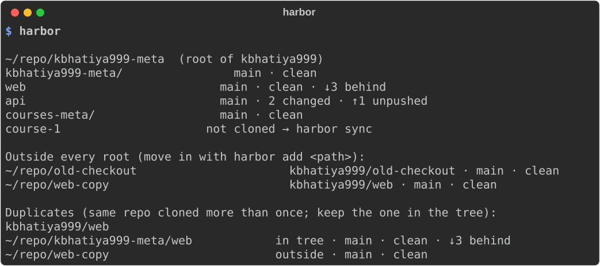
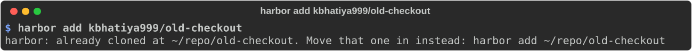

# Commands

Every command that changes something prints one line per change. *Changes*
below lists everything each command can write.

`add`, `new` and `sync` act on the meta repo you're in. Use `--in <path>` to
pick another one. Outside every root, they use the root of the active `gh` account.

## `harbor` / `harbor status`

Shows every root, meta repo and repo, after a fetch.

```sh
harbor
harbor status --offline   # skip the fetch; ahead/behind as of the last fetch
```



For each repo it shows the branch, uncommitted changes, `↑` unpushed and `↓` behind
commits, and flags:

| Flag | Meaning | Fix |
|------|---------|-----|
| `not cloned` | listed in `mani.yaml`, missing on disk | `harbor sync` |
| `not adopted` | meta repo without `.copier-answers.yml` | `harbor adopt <path>` |
| `template vX → …` | meta repo on an older template | `harbor sync` |
| `origin is …, mani.yaml says …` | clone points somewhere else than its manifest entry | fix the remote or the entry |
| clone not listed in `mani.yaml` | a git repo inside a meta repo folder that isn't tracked | `harbor add <path>` |
| Outside every root | a clone under `~/repo` outside every tree | `harbor add <path>` |
| Duplicates | the same repo cloned more than once | keep the one in the tree, delete the other once it shows *clean* and nothing unpushed |

It also reports when a newer harbor is released.

**Changes:** none, apart from fetching remote refs.

## `harbor init [account]`

Sets up the root for `account` (default: the active `gh` account). It adopts the
local root, or clones it from GitHub and adopts it, or creates it.
See [Getting started](getting-started.md#1-set-up-your-root).

**Changes:** possibly a new private GitHub repo `<account>/<account>-meta`; the
local root (clone or scaffold, plus one adoption commit);
`~/.config/harbor/<account>.gitconfig`; one `includeIf` entry in `~/.gitconfig`.

## `harbor sync [--in META]`

Brings the meta repo and everything under it up to date. See
[Safe sync](concepts.md#safe-sync).

**Changes:** clones missing repos; rebases clean branches that are behind;
applies template updates to clean meta repos (one commit each); refreshes the
`# mani #` block in `.gitignore`/`.ignore` (one commit); pushes meta repos'
unpushed commits.

It never clones a repo that already exists elsewhere under `~/repo`, never
touches uncommitted work, and never pushes a regular repo.

## `harbor add <repo> [--name NAME] [--in META]`

Adds a repo to a meta repo. `<repo>` can be:

- `owner/repo` or a GitHub URL, which harbor clones into the meta repo
- a path to an existing clone, which harbor **moves** into the meta repo (it refuses if the clone has extra worktrees)

It refuses if the repo is already tracked anywhere, or already cloned somewhere
else. In that case it tells you to add *that* path instead, so the existing copy is moved in:



**Changes:** the clone or move; a new entry in `mani.yaml`; the `# mani #` ignore
block; one local commit in the meta repo (pushed by the next `harbor sync`).

## `harbor new <name> [--description TEXT] [--in META]`

Creates a nested meta repo under your account. It refuses if
`<account>/<name>` is tracked, cloned or already on GitHub.

**Changes:** a new private GitHub repo; the scaffolded meta repo (one commit,
pushed); an entry in the parent's `mani.yaml` plus one local commit in the parent.

## `harbor adopt [path]`

Applies the template to an existing meta repo (default: the current folder). It
refuses if the repo has uncommitted changes. Files the repo already has are kept.
Template-managed ones among them (`mise.toml`, `AGENTS.md`, `CLAUDE.md`) are
recorded as `keep`, so later updates won't touch them.

**Changes:** the template's missing files, `.copier-answers.yml`, the ignore
block; one local commit.

## `harbor --version`

Prints the harbor version and the template tag it renders.
