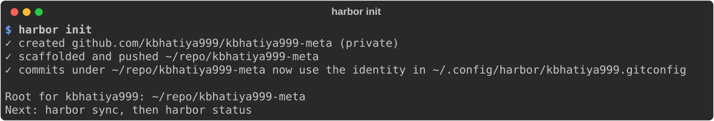
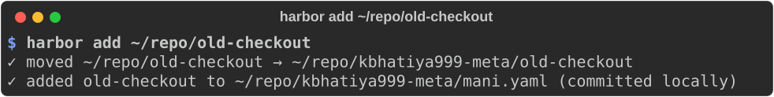
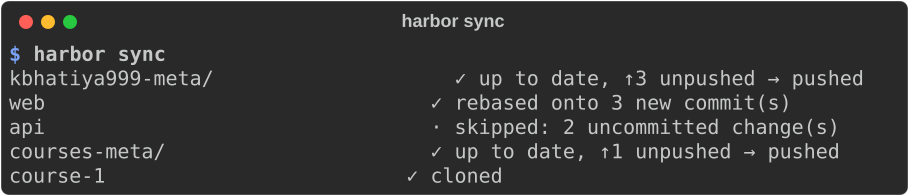

# Getting started

## Requirements

- [uv](https://docs.astral.sh/uv/), which installs and runs harbor
- [git](https://git-scm.com)
- [GitHub CLI](https://cli.github.com), logged in to every account you use (`gh auth login`)

## Install

=== "Install (recommended)"

    ```sh
    uv tool install harbor-meta
    harbor --version
    ```

=== "Run without installing"

    ```sh
    uvx harbor-meta
    ```

=== "Setup script"

    ```sh
    bash <(curl -fsSL https://raw.githubusercontent.com/kbhatiya999/meta-template/main/setup.sh)
    ```

    On Windows PowerShell:

    ```powershell
    irm https://raw.githubusercontent.com/kbhatiya999/meta-template/main/setup.ps1 | iex
    ```

The package is called `harbor-meta` because `harbor` is taken on PyPI. The
command is `harbor`.

## 1. Set up your root

```sh
harbor init
```

This works with the active `gh` account. Pass an account name to use another one:
`harbor init some-account`. Depending on what already exists, it does one of three things:

| You have | harbor init |
|----------|-------------|
| `~/repo/<account>-meta` locally | adopts it. Your `README.md`, `mani.yaml` and `.gitignore` are kept |
| `<account>/<account>-meta` on GitHub only | clones it, then adopts it |
| neither | creates a private GitHub repo and scaffolds it |



It also makes commits anywhere in the tree use the account's name and email.
It does this by adding a git `includeIf` to `~/.gitconfig` that points at
`~/.config/harbor/<account>.gitconfig`. Every change is printed.

## 2. Bring your repos in

=== "A repo you already cloned"

    ```sh
    harbor add ~/code/api
    ```

    The clone is **moved** into the current meta repo, so you still have one copy.

    

=== "A repo on GitHub"

    ```sh
    harbor add kbhatiya999/web
    ```

=== "A new group of repos"

    ```sh
    harbor new courses-meta --description "Course material"
    harbor add kbhatiya999/course-1 --in courses-meta
    ```

`add` and `new` act on the meta repo you're in. `--in <path>` picks a different one,
and outside every root they use the active account's root.

## 3. Daily loop

```sh
harbor          # what's changed, unpushed or behind, and anything out of place
harbor sync     # clone what's missing, rebase what's safe to rebase
```



Then open the root (or any meta repo) in your editor as one workspace. Zed,
VS Code and Cursor all open a folder of repos natively.

## On a new machine

```sh
uv tool install harbor-meta
gh auth login
harbor init     # clones your root from GitHub
harbor sync     # clones everything in it
```
